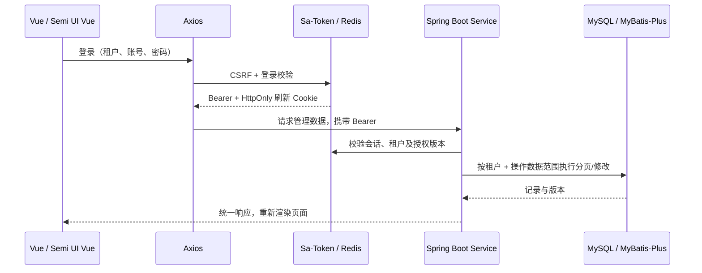

# 10. 系统管理后台与前端联调

更新：2026-10-19。本章描述实际代码；第 1–9 章保留为整体平台的规划设计，不代表其中所有能力均已实现。

## 10.1 本次范围

用户要求 Java 17、Spring Boot 3、MyBatis-Plus 3.5、MySQL、Redis、Sa-Token，优先完成系统管理全部后台并接通 Vue 3 + Semi UI Vue + Axios 前端。

已落实五个模块：用户、角色、菜单、部门、岗位，以及这些模块依赖的认证、权限、个人资料与密码流程。
`backend/` 是 Spring Boot 模块化单体，`front/` 保留原有 UI；真实模式使用 `SystemManagement.vue`，纯原型模式使用原有 `Management.vue`。

## 10.2 真实数据流

管理数据不写 localStorage。下拉选项、部门筛选和角色授权均使用后端字符串 ID。列表分页、查询、排序与 Excel 导出由后端执行。

## 10.3 通用接口

基础路径 `/api/v1`。JSON 响应 `{code:"OK",message:"成功",data,traceId}`。ID 使用十进制字符串，时间使用 UTC ISO 8601，前端按上海时区显示。

- 列表：`page` 从 1 开始，`size` 1–100；`keyword/status/deptId/sort/direction`。
- 排序白名单：公共 `name/status/createdAt/id`，以及资源允许的 `username/phone/code/scope/sort/type/path/permission`。
- 更新与状态变更必须带 `version`；批量删除每条都带 id/version。冲突 409，整批事务回滚。
- 400 字段不合法；401 会话失效；403 无权限；404 不存在/范围外；409 重复、版本或引用冲突；429 登录失败限流；503 必要依赖不可用。
- 安全敏感未知字段拒绝，例如向请求体注入 tenantId/passwordHash。
- 成功创建 201，普通查询/修改 200，无响应删除/改密/退出 204。
- 导出由 EasyExcel 生成标准 `.xlsx`，中文表头，ID、手机号和类似公式的内容按文本写入，最多 10,000 条；用户导入支持 Excel 模板、预览与整批事务回滚。

## 10.4 认证端点

| 方法 | 路径 | 行为 |
| --- | --- | --- |
| GET | /auth/csrf | 生成绑定 HttpOnly 预会话 Cookie 的 CSRF token |
| POST | /auth/login | tenantCode、username、password；校验来源与 CSRF |
| POST | /auth/refresh | 轮换刷新 Cookie；旧凭据重放撤销会话 family |
| POST | /auth/logout | 撤销会话 family 并清 Cookie |
| GET | /auth/me | 用户资料、角色、permissions、admin、mustChangePassword、tenant |
| GET | /auth/menus | 已授权菜单树；前端据此生成导航与搜索 |
| PATCH | /auth/profile | name、email、phone、bio |
| PATCH | /auth/password | oldPassword、newPassword；改密后重新登录 |
| GET | /dashboard/overview | 授权范围内系统计数及本人最近操作 |
| GET | /health | 应用存活探针，不代表依赖 readiness |

访问令牌 15 分钟。刷新凭据 7 天绝对有效期、24 小时空闲期；Redis Lua 原子消费并保留重放标记。
Axios 对非认证请求的 401 合并刷新并重试一次；刷新失败回登录。页面重载通过刷新 Cookie 恢复登录。浏览器 Web Locks 串行处理跨标签页刷新。

## 10.5 五个系统模块

`resource` 可取 `users / roles / menus / depts / posts`，权限前缀分别为 `system:user / role / menu / dept / post`。

| 方法 | 路径 | 权限后缀 |
| --- | --- | --- |
| GET | /system/{resource} | list |
| GET | /system/{resource}/{id} | read |
| POST | /system/{resource} | create |
| PATCH | /system/{resource}/{id} | update |
| PATCH | /system/{resource}/{id}/status | update |
| DELETE | /system/{resource}/{id}?version=0 | delete |
| POST | /system/{resource}/batch-delete | delete |
| GET | /system/{resource}/export | export |
| GET | /system/menus/tree、/system/depts/tree | 对应 list |
| GET | /system/options | 当前账号允许的关联选项 |
| PUT | /system/users/{id}/roles | system:user:assign-role |
| POST | /system/users/{id}/password-reset | system:user:reset-password |
| PUT | /system/roles/{id}/permissions | system:role:grant |

角色及菜单变更、新增用户、用户角色授权额外要求内置租户管理员。普通角色即使勾选安全管理权限也不会自动取得管理员身份。管理员自身的基础资料通过个人中心维护。

### 写入字段

所有更新额外传 version；无需传 id、createdAt、tenantId。展示用的 department/role/post/parent 来自后端关联查询，不能作为写入关联。

| 资源 | 字段 |
| --- | --- |
| users | username、name、deptId、roleIds[]、postIds[]、email、phone、remark、status；新增另带 initialPassword |
| roles | name、code、scope、status、remark |
| menus | name、parentId、type、path、permission、sort、icon（可选）、status |
| depts | name、parentId、leader、phone、sort、status、remark |
| posts | name、code、sort、status、remark |

- status：`启用/停用`；菜单 type：`目录/菜单/按钮`。
- scope：`全部数据/本部门及下级/本部门/自定义部门/仅本人`。
- 父 ID 为 null 或空字符串时表示顶级节点。禁止循环、跨租户、按钮做父节点，以及启用子节点挂在停用节点下；最多 32 层。
- 用户必须选择启用部门、至少一个启用角色；岗位可多选。账号创建后不可修改。
- 密码至少 12 字符且不超过 72 UTF-8 字节，包含字母和数字，BCrypt cost 12。新用户/重置密码后建议在个人中心改密，正常加载菜单和业务页面；不会返回密码哈希。
- 角色授权体：`{menuIds:[],scope:"自定义部门",deptIds:[],version:0}`。
- 用户角色分配体：`{roleIds:[],version:0}`。
- 重置密码体：`{newPassword:"...",version:0}`。
- 批量删除体：`{items:[{id:"...",version:0}]}`。

## 10.6 数据库与一致性

`db/schema.sql` 创建 12 张表：租户、用户、角色、菜单、部门、岗位、用户角色、用户岗位、角色菜单、角色部门、账号申请、审计。已移除 Flyway，采用 schema.sql/data.sql 显式初始化。已有库执行 schema.sql 补建账号申请表，保留现有数据。
所有关系的联合外键包含 tenant_id。部门和岗位仍被引用时不允许删除。用户管理删除选中账号时，在同一事务物理删除该账号、角色/岗位绑定，以及本租户按 user_id 或账号匹配的注册和找回密码申请，保留其他用户及全部角色、部门、岗位。删除普通角色仅解除该角色的用户绑定并清除菜单/部门授权，保留全部用户。内置管理员和当前账号受保护，校验或版本冲突时整批回滚；审计保留历史 ID。菜单删除同步移除角色授权关联。

MyBatis-Plus 执行实体 CRUD 和分页；JdbcTemplate 执行固定、参数化关系 SQL、锁与审计。所有动态表名/排序字段均来自代码白名单。

授权每次从数据库获取；仅合并拥有当前操作权限的角色的数据范围。用户编辑/停用/角色变化/改密通过 authVersion 撤销旧会话。角色权限、范围及启停通过实时查询立即生效，不依赖 Redis 缓存刷新。

写事务先锁本租户并重新鉴权，隔离级别 READ COMMITTED；这是管理平台优先正确性的策略。数据库成功操作审计与主数据同事务提交。

## 10.7 与早期设计稿的明确差异

- 技术栈以用户最终选择为准：Sa-Token 替代规划中的 Spring Security 认证；仅复用 spring-security-crypto 做 BCrypt。前端 Semi UI Vue + npm，未使用 Element Plus / pnpm。
- 目录使用 backend / front，当前采用单 Maven 模块中的包隔离，未机械拆成多个 Maven 子项目。
- 本次仅完成五个系统模块。数据管理的字典/参数、业务、文件、日志查询及监控后台仍为后续阶段。
- 状态/类型/范围暂与现有中文界面枚举保持一致；ID 关联已标准化。完整 OpenAPI 自动生成暂未配置，契约集中于 Inputs.java 和前端 system-live.ts。
- 物理删除加引用保护，未实现软删除回收站；成功审计已落库，失败审计/登录日志/告警 outbox 未实现。
- 不做授权缓存/发布栅栏；数据库实时校验承担撤权一致性。Sa-Token 存储格式遵循所用 Redis 插件，并非此前“所有访问令牌均仅存摘要”的自研方案。
- 角色/菜单安全配置与用户授权限内置租户管理员。可委派授权管理、多租户平台运维端、MFA 不是本阶段内容。
- 首页真实模式展示用户、角色、部门、岗位和本人操作；没有用原型 1248 用户等演示数字冒充数据库统计。

## 10.8 验证与运行

启动、环境变量、已有数据库和独立容器说明见 [backend/README.md](../backend/README.md)。

自动检查包括：Java 密码策略与哈希测试；真实 HTTP/数据库/Redis 的授权、租户、数据范围、CRUD、冲突、树引用、刷新重放和失效测试；真实浏览器五模块操作与移动布局；原有 Mock 页面回归。

联调结果与当前运行环境见 [第 11 章验收记录](11.系统管理联调验收记录.md)。切换 MySQL / Redis 环境后应重新验证，不将独立实例的结果混同为已有环境的结果。
