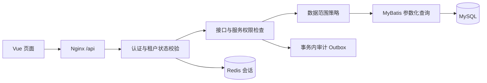

# 7. 前后端开发

## 7.1 后端结构与边界

采用 Controller → ApplicationService → Domain/Policy → Mapper/Infrastructure。Controller 处理请求绑定与校验；服务层负责事务、权限、业务约束；Mapper 执行参数化 SQL。Entity、Request DTO、Response VO 分离，禁止 BeanUtils 无差别复制安全字段。

SecurityContext 中统一保存 actorId、tenantId、identityType、sessionId、authVersion；租户身份的 tenantId 不从查询参数或 X-Tenant-Id 获取。平台域使用独立认证入口与会话命名空间，不能复用租户身份直接切换平台身份。



## 7.2 RBAC 判断规则

1. 用户、租户必须有效，角色和菜单停用即不参与授权。
2. 功能权限取有效角色的权限并集；权限码精确匹配，首版不支持客户端定义通配权限。
3. 请求匹配规则与方法级授权双重执行；公共入口显式列出，未匹配业务接口默认拒绝。
4. 自定义 `hasPermission('system:user:create')` 等表达式统一访问权限服务，不能每个 Controller 自行拼接逻辑。
5. 角色可授予集合为操作者拥有且被标记可委派的权限；系统保留权限和内置管理员角色不能普通委派。
6. 为目标角色增权时，同时校验数据范围不超过操作者可授予范围；同租户并不意味着有权扩大到 ALL。
7. 租户管理员具有本租户管理能力，仍执行租户过滤、字段保护和关键操作审计；禁止通用超级管理员绕过拦截器。

菜单展示权限和业务访问权限分开：拥有父目录不等于拥有子按钮；已授权子菜单可补齐导航祖先，但祖先不因此获得接口权限。页面按钮隐藏仅改善体验，后端是授权裁决点。

## 7.3 数据权限算法

```text
允许操作 = 有效身份
        AND 资源.tenant_id = 当前tenantId
        AND 拥有当前操作permissionCode
        AND (当前操作相关角色的数据范围并集包含该记录)
```

只合并**拥有当前 permissionCode 的角色**的数据范围。例如 A 角色有项目查看+ALL，B 角色有项目编辑+SELF，则用户可查看全部项目，只可编辑本人项目，不能将 ALL 传播到编辑操作。

| 范围 | 规则 |
| --- | --- |
| ALL | 本租户全量，绝不跨租户 |
| DEPT_AND_CHILD | 当前用户所在部门及闭包表中的后代部门 |
| DEPT | 当前用户所在部门 |
| CUSTOM | 当前角色显式绑定的部门集合，不自动扩展子部门 |
| SELF | owner_user_id 为当前用户；用户管理中映射为 user.id |

无部门时 DEPT/DEPT_AND_CHILD 为空；无相关角色、CUSTOM 为空、未知范围默认拒绝。无 owner/dept 字段的资源必须注册专用策略；不能因为无法过滤就按 ALL 处理。系统配置、角色、菜单等使用专门的本租户管理权限，不套用业务项目的 owner 模型。

所有列表、详情、统计、更新、删除、导出、批量操作执行相同范围策略。更新/删除 SQL 本身带 tenant_id、数据条件和 version；不能只先查再无条件按 id 更新。新增时从上下文确定 owner/dept，指定其他 owner/dept 需验证目标用户、部门和委派权限。受限列表结果内的 total 也是过滤后的数量。

MyBatis 租户插件配置只允许显式排除平台表；数据范围使用经过审查的统一查询策略，手写 SQL、JOIN、子查询和异步任务需专项验证。服务端固定表别名，查询条件参数化，禁止直接拼接来自请求的 SQL 片段。

## 7.4 会话生命周期

- 访问令牌 15 分钟，刷新令牌绝对有效期 7 天、空闲期 24 小时，均为建议默认值，可集中配置。
- 两种 token 使用密码学随机值（至少 256 位），数据库/Redis 存摘要而非原始令牌；会话绑定 tenantId、userId、authVersion、创建及过期时间。
- 访问请求读取 Redis 会话并检查租户状态、用户状态及授权版本。Redis 不可用时受保护接口失败关闭并返回 503，不降级放行。
- 刷新使用原子消费及轮换，旧 token 不可再次签发；检测重放撤销整个 token family，并记录安全事件。
- 前端单页面使用 single-flight 合并刷新；跨标签页通过 Web Locks/BroadcastChannel 串行刷新，拿到锁后先检查另一页广播的新访问令牌。无法协调时过期刷新失败后重新登录，不放宽重放规则。
- 退出撤销本会话及关联访问令牌；改密、重置密码、停用用户、停用租户撤销相关全部会话。
- 登录限流按 IP+租户+账号组合，避免单 IP 误伤整家企业；密码失败统一提示“账号或密码错误”。
- 密码采用 Spring PasswordEncoder 支持的强哈希方案并按环境基准调节成本；最少 12 位，允许长密码，禁止明文/可逆存储。MFA 为 P2。

CSRF/Origin 规则见第 5 篇。Cookie 认证仅用于 auth 生命周期接口。开发同源代理与生产同域 Nginx 保持一致，默认不开全域 CORS。

## 7.5 授权变更与缓存一致性

角色权限、范围、用户角色或部门变化在同一事务修改主数据与授权版本。缓存键至少包含 tenantId、userId、authVersion；角色与部门变更需要影响到相关用户的版本。

授权版本以数据库为事实源，Redis 作为执行侧镜像。安全变更设置 Redis 撤销/变更栅栏，提交后同步发布新版本；发布失败保留栅栏并拒绝受影响会话访问，由事务 outbox 重试恢复。不能仅依赖 Pub/Sub 或 TTL 宣称权限立即撤销。接口只有在版本发布成功后返回变更完成，否则返回明确处理中/失败并让受影响身份保持拒绝状态。

后续实施必须测试“数据库已提交、Redis 发布失败”和进程中断恢复；允许的撤销传播上限定义为 5 秒，期间受影响身份应被栅栏拒绝。列表性能缓存不能绕过该校验。前端通过 me 的版本变化重取菜单和权限。

## 7.6 文件与审计

文件元数据与内容分开；开发本地存储适配器和生产私有对象存储使用相同业务接口。校验扩展名、MIME、文件头、大小，默认不允许 HTML/SVG/脚本作为可执行预览。对象键用随机值，原文件名只做显示；下载使用 attachment 和 nosniff。

文件上传后处于扫描/隔离状态；通过后才允许关联、下载。未关联文件仅上传者或专门文件管理员可访问；关联文件还需对应业务资源可读权限。检查文件租户与业务租户完全一致。对象删除失败由可重试任务清理，不能把失败静默视为完成。

操作审计记录操作者、租户、动作、资源、结果、耗时、IP、traceId 和脱敏摘要；不存密码、token、完整文件正文。授权/改密/停用等关键成功操作与 outbox 同事务；失败审计用独立可靠路径落地，不能被业务回滚吞掉。IP 仅信任已配置反向代理的转发头。

## 7.7 联调顺序

先实现登录与 me/menus → 用户及组织 → 角色授权 → 数据范围 → 首页 → 文件/日志/监控。前端请求模型从 OpenAPI 生成或集中维护，ID 全程 string，避免 Number 精度丢失。

每模块准备两租户、两部门、多角色、停用账号和无权限账号，真实运行列表/详情/写入反例。mock 仅开发可用，生产构建禁止引入。下载、过期刷新、跨标签页、退出后浏览器后退都纳入联调。
