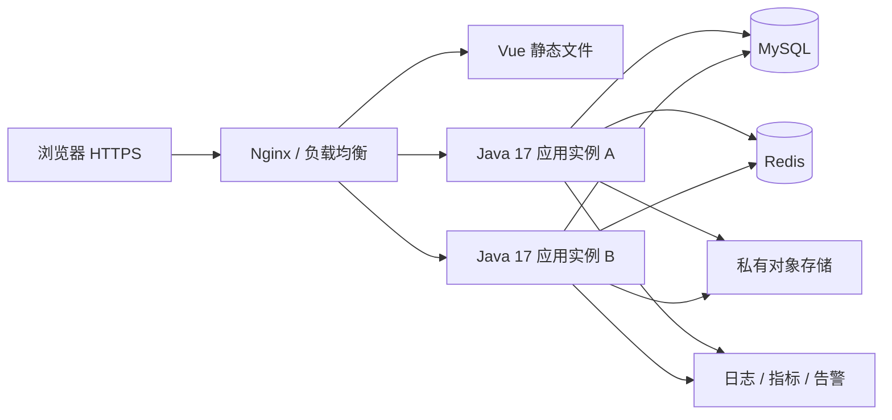

# 9. 部署上线

## 9.1 部署拓扑



首版可用单机 Compose，生产按可用性要求部署多实例和有备份/高可用的 MySQL、Redis。共享会话放 Redis，不依赖 sticky session。应用实例间不共享本地文件；生产文件写私有对象存储。

## 9.2 环境与制品

- local、test、staging、prod 使用独立数据库、Redis、文件桶与密钥。
- 后端构建和运行使用 Java 17；Maven Wrapper、前端 pnpm/Node 版本与第 1 篇一致。
- 后端 `mvnw.cmd clean verify` 后生成启动模块 jar；前端 `pnpm install --frozen-lockfile`、检查与 `pnpm build` 输出 dist。
- CI 构建一次，使用 commit SHA/发布号标记镜像并记录 digest，同一制品逐环境晋级。
- 不在镜像内放生产 .env，不使用浮动 latest；基础镜像初始化时验证后锁定 digest。

后端镜像设计：Java 17 JRE、非 root 用户、只读根文件系统、限制内存/CPU、只给临时目录写权限。使用容器感知 JVM 内存参数，保留堆外内存余量。Java 17 不使用虚拟线程等更高版本特性。

## 9.3 运行配置

| 配置 | 生产要求 |
| --- | --- |
| 数据库 | 私网地址、专用 DML 账号、连接超时、连接池容量与实例数共同核算 |
| Redis | 私网、认证、按条件启用 TLS；禁止公开映射公网；会话过期策略明确 |
| Cookie | Secure、HttpOnly、SameSite=Lax、路径限定；全链路 HTTPS |
| 对外地址 | 固定 APP_PUBLIC_ORIGIN；Origin 与 CSRF 校验开启 |
| 存储 | 私有桶、最小权限凭据、上传限制、扫描/隔离流程 |
| 日志 | 结构化 JSON、traceId、脱敏；禁止 DEBUG 输出凭据 |
| 管理端点 | 探针按最小暴露，其余 Actuator、metrics 仅内网及授权身份可用 |
| OpenAPI | 生产关闭公开入口，或放内网认证访问 |

Nginx `/api/` 转发时保留完整 `/api/v1` 路径；静态资源使用带 hash 文件名长缓存，index.html no-cache；SPA 访问回退 index.html，但 `/api` 错误不得回退 HTML。上传上限与后端一致，生产仅信任明确反向代理地址的 forwarded headers。

## 9.4 数据库发布策略

1. 发布前备份并验证备份可读，记录 schema 版本、迁移脚本校验和与恢复点。
2. 通过独立迁移 Job 使用 DDL 账号执行 Flyway；生产应用启动不并发自动迁移。
3. 优先 expand-contract：先增加兼容字段/表，部署兼容旧新 schema 的应用，再回填并最终收缩。
4. 大表 DDL 提前评估锁表和耗时；不在日常上线直接执行大批量无界 UPDATE。
5. 种子升级任务幂等且按租户处理；新增权限不自动赋给普通角色。
6. 迁移失败停止应用发布，保留诊断信息；不随意 repair 清除失败记录或编辑已执行脚本。

删除列、改字段含义、不可逆回填等变更必须单独安排窗口。Flyway 迁移成功不等于数据语义正确，仍需验证管理员、租户与权限种子。

## 9.5 发布步骤

1. 在 staging 部署同一 digest，执行适用的第 8 篇用例及真实代理/Cookie 联调。
2. 检查数据库容量、备份、告警接收人、存储权限、证书有效期及版本清单。
3. 执行增量迁移，完成必要初始化，不生成固定默认密码。
4. 启动新实例，readiness 检查数据库、Redis及必要依赖；liveness 不因数据库短暂中断杀死所有实例。
5. 小比例流量观察 15–30 分钟，比较错误率、延迟、鉴权失败、连接池与审计积压。
6. 达到阈值后逐步切换全部流量；优雅停止旧实例，等待进行中请求完成。
7. 用专用验收租户进行登录、授权、跨租户拒绝、改密、文件、日志冒烟；不使用真实用户数据作破坏性测试。

尚未建立实际部署文件。未来 Compose 发布入口约定如下，须在文件创建并审查后执行：

```powershell
docker compose --env-file .env.prod -f deploy/compose/compose.prod.yml config --quiet
docker compose --env-file .env.prod -f deploy/compose/compose.prod.yml pull
docker compose --env-file .env.prod -f deploy/compose/compose.prod.yml up -d
```

`config --quiet` 避免在日志展开环境密钥。不要在生产执行 `down -v`；镜像回滚不等于数据库回滚。

## 9.6 回滚预案

建议触发条件：5xx 连续 5 分钟 >1%、核心接口 P95 超过验收值两倍并持续 10 分钟、主要租户无法登录。发现跨租户泄露或授权绕过应立即停止相关入口并启动事件处理，不等待观察期。

应用回滚：恢复上一已验证镜像 digest 和静态资源版本；确认旧应用兼容当前 schema；流量回切后执行登录、用户列表及权限拒绝冒烟。前端旧 chunk 保留一段发布窗口，避免已打开页面资源 404。

数据库：优先向前修复；如需恢复备份，先停止写入，评估恢复点之后的数据损失并按企业发布责任流程批准。禁止直接删表、清空 Redis 全库或运行未经演练的反向 SQL。跨版本修改了 token 格式时明确旧会话兼容期，必要时撤销会话要求重登。

## 9.7 监控与运行手册

| 指标 | 初始告警建议 |
| --- | --- |
| API 可用性 | 5xx >1% 持续 5 分钟；401/403 单独统计并分析异常增长 |
| 依赖 | MySQL/Redis 不可用立即告警；连接池等待及慢查询增长 |
| 资源 | CPU/内存/磁盘持续高位、容器重启、证书临期 |
| 安全 | 刷新重放、批量登录失败、跨租户访问拒绝、关键管理员变更 |
| 审计 | outbox 最老待投递 >60 秒或重试持续失败 |
| 文件 | 扫描失败、孤立对象积压、存储容量及失败率 |

日志以 traceId 关联 Nginx、应用、审计，限制读取人员；不对普通租户开放 JVM 环境变量/系统配置快照。生产排障临时提权需有期限和审计。

建议数据库每日全量备份+持续 binlog，对象存储版本化；备份加密并异地保存，Redis 持久化策略需覆盖会话及栅栏状态。初始目标 RPO ≤15 分钟、RTO ≤60 分钟，必须通过季度恢复演练验证后才能作为承诺。

## 9.8 上线交付清单

- 版本清单、镜像 digest、数据库迁移记录、配置变量说明。
- 测试报告、已知问题、权限目录、初始化及管理员恢复流程。
- HTTPS/备份/告警验证、回滚演练证据、运维联系人。
- 首次管理员已改密，生产 mock/调试入口关闭，无固定密码或密钥进入仓库。
